# 🎬 Netflix insights: what the world actually watches

**17,370 titles and 23.4 billion views from Netflix's own published data, joined to IMDb, plus three recommenders tested against each other.** Which films and series win, which genres and directors, how fast interest fades, which countries share a taste, and what really drives recommendations.


---

## How it works

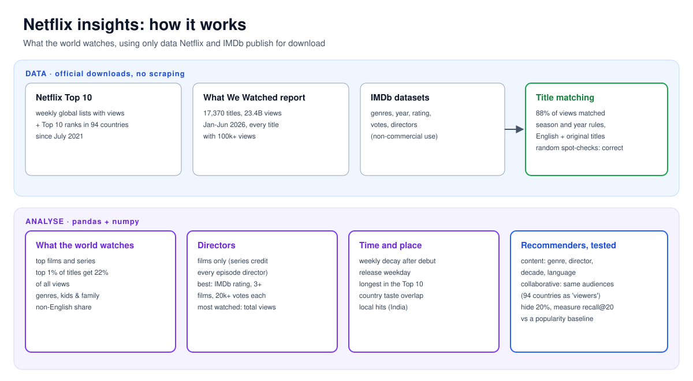

## What we get from it

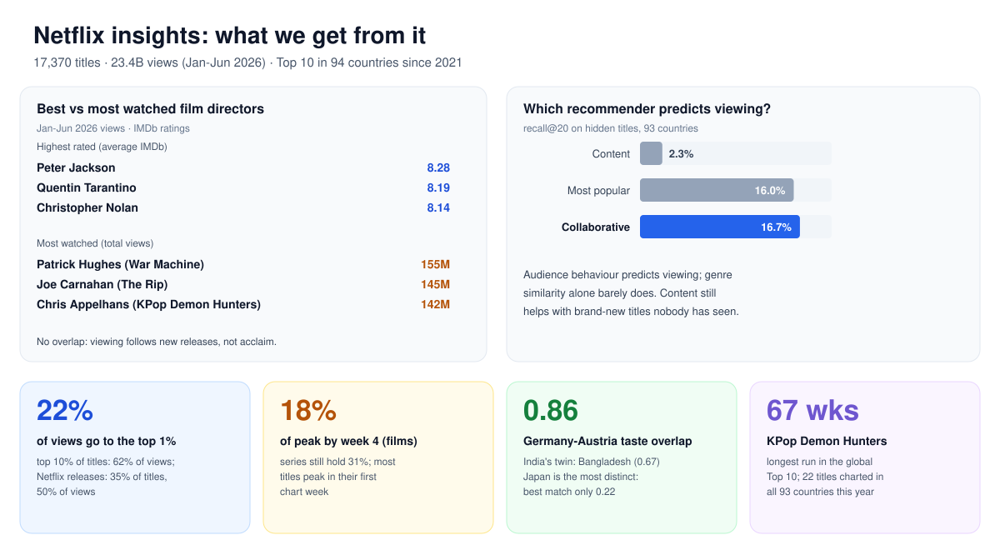

## The data (no scraping)

Netflix's website is behind a login and its terms forbid scrapers, so this project uses only files that are **published for download**:

| Source | What it has |
|---|---|
| [Netflix Top 10](https://www.netflix.com/tudum/top10) | weekly global Top 10 lists with views (since 2023) and ranks in 94 countries (since July 2021) |
| [Netflix "What We Watched" report](https://about.netflix.com/news/what-we-watched-the-first-half-of-2026), Jan-Jun 2026 | views and hours for **every** title with 100k+ views: 17,370 titles, 23.4B views |
| [IMDb non-commercial datasets](https://developer.imdb.com/non-commercial-datasets/) | genres, year, rating, votes, directors |

**What isn't public:** Netflix does not publish viewers' **ages** or the **time of day** people watch. The closest honest proxies used here are the Animation/Family genre share (for kids' viewing) and *when in a title's life* it is watched (weeks after release, release weekday).

**Matching Netflix titles to IMDb** handles seasons ("Bridgerton: Season 4"), bare season numbers ("Stranger Things 5"), year tags ("Madagascar (2005)"), English plus original-language titles ("Squid Game // 오징어 게임"), and remakes (Netflix's 2023 *One Piece*, not the 1999 anime). **88% of views** are matched, and random spot-checks were all correct. Two bugs found along the way are now regression tests: Hindi/Korean titles collapsing to an empty key, which matched a 1971 film called "$", and "모범택시3" collapsing to "3".

## Findings

### 1. Most watched worldwide (Jan-Jun 2026)

| Films | Series |
|---|---|
| 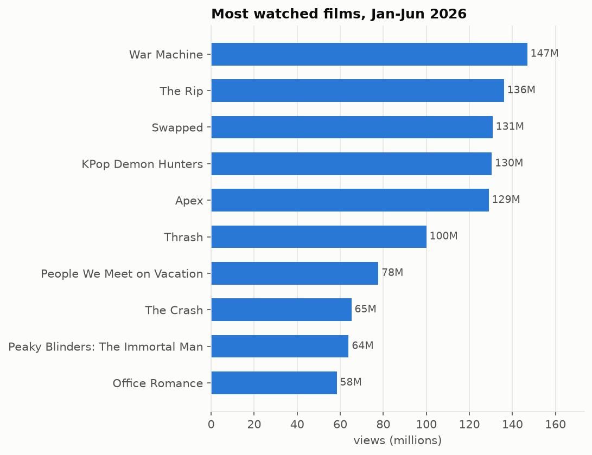 | 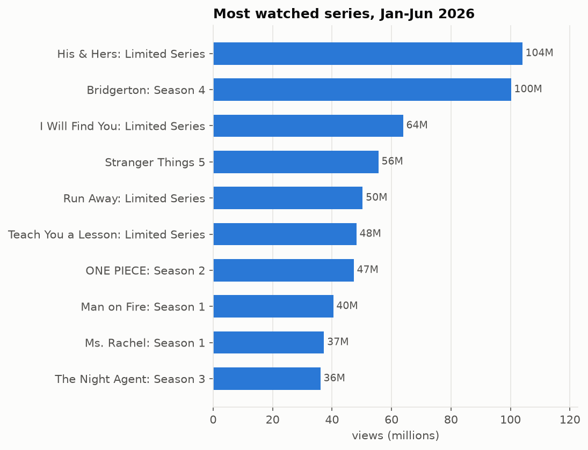 |

- Viewing is **highly concentrated**: the top 1% of titles get **22%** of all views, and the top 10% get **62%**.
- Titles Netflix released itself are **35% of titles but 50% of views**. Non-English titles are **20%** of views; films **55%**.
- **KPop Demon Hunters** has spent **67 weeks** in the global Top 10, the longest run in the data. **22 titles** charted in all 93 countries in the past year.

### 2. Genres and audience

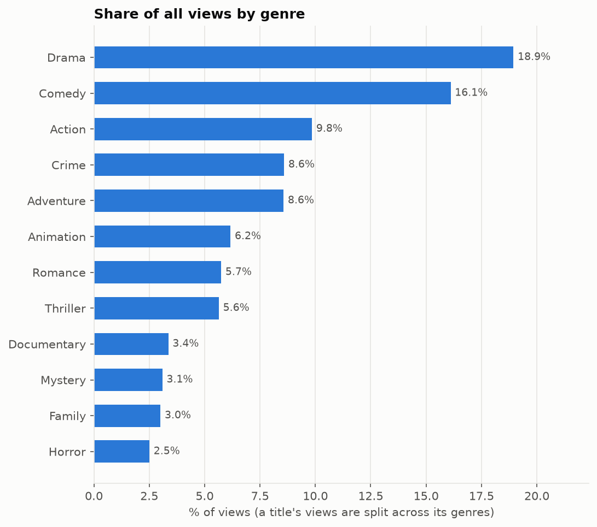

Drama (19%) and Comedy (16%) dominate by volume, but Adventure titles get the most views *per title* (median 700k vs 300k for Drama). **Animation/Family titles take 23% of views from 18% of titles**, so kids and families over-index. The top kids' titles are *Swapped*, *KPop Demon Hunters*, *Madagascar*, *Goat* and *Ms. Rachel*.

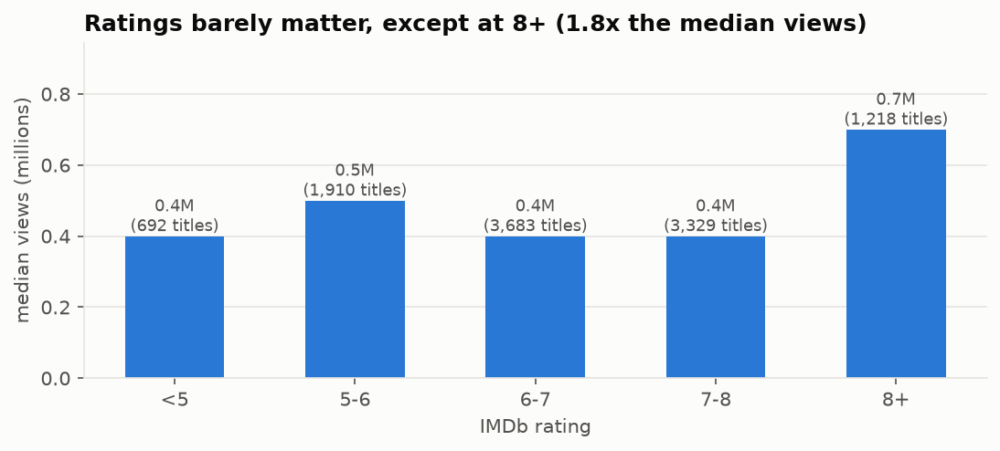

**Ratings barely predict views.** A title rated under 5 gets about the same median views as one rated 7-8. Only 8+ titles stand out (1.8x the median). *Thrash* (IMDb 5.0) got 100M views.

### 3 & 4. Best directors vs most watched directors

| Best (average IMDb rating) | Most watched (views, Jan-Jun 2026) |
|---|---|
| 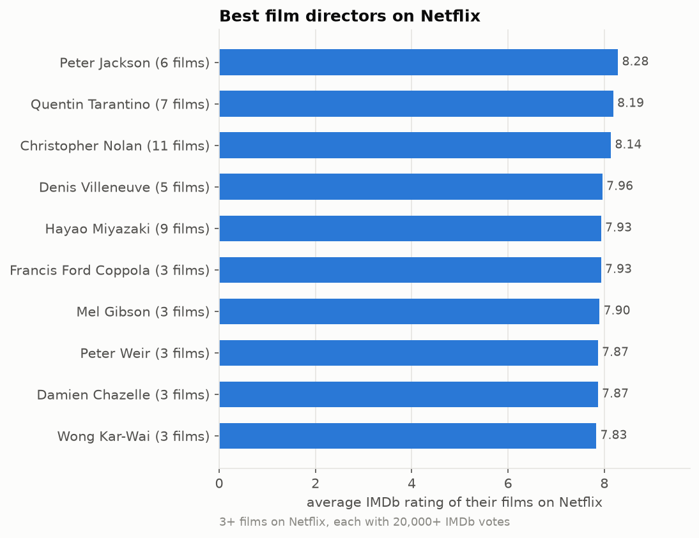 | 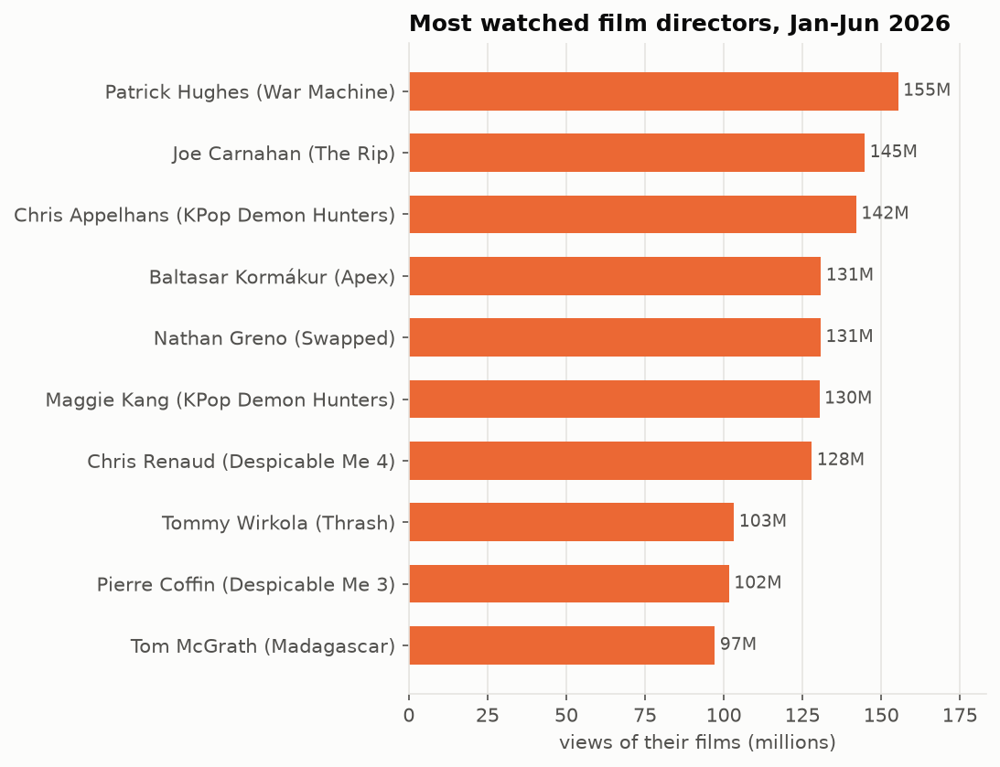 |

**The two lists don't overlap at all.** The best-rated directors on Netflix are Peter Jackson, Tarantino, Nolan, Villeneuve and Miyazaki. The most watched are the directors of new Netflix releases: Patrick Hughes (*War Machine*), Joe Carnahan (*The Rip*), and the *KPop Demon Hunters* directors. Directors are analysed for **films only**, because for a series IMDb credits every episode director.

### 5. Time: interest fades fast

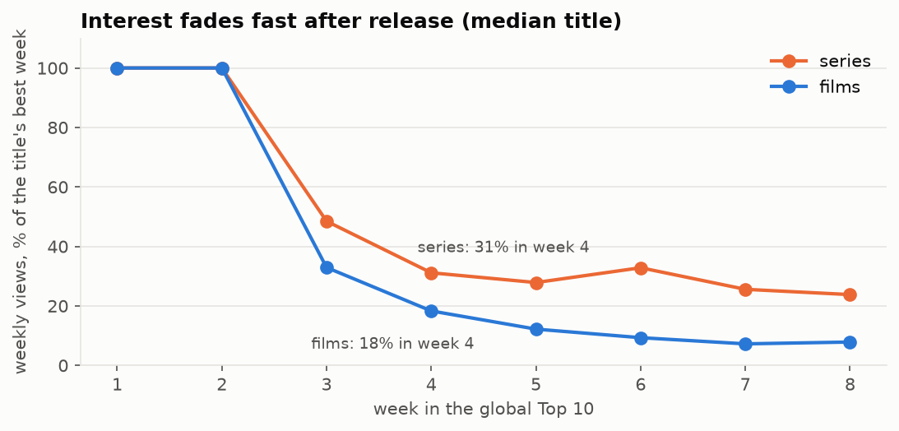

66% of titles peak in their first Top 10 week. By week 4 the median film is down to **18%** of its peak, while series hold **31%**: people binge a series over weeks but watch a film once.

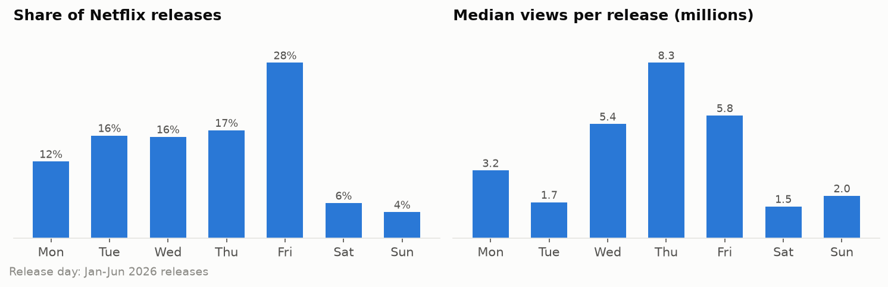

Netflix releases most titles on **Friday** (28%), but **Thursday** releases have the highest median views (8.3M).

### 6. Which countries watch the same things?

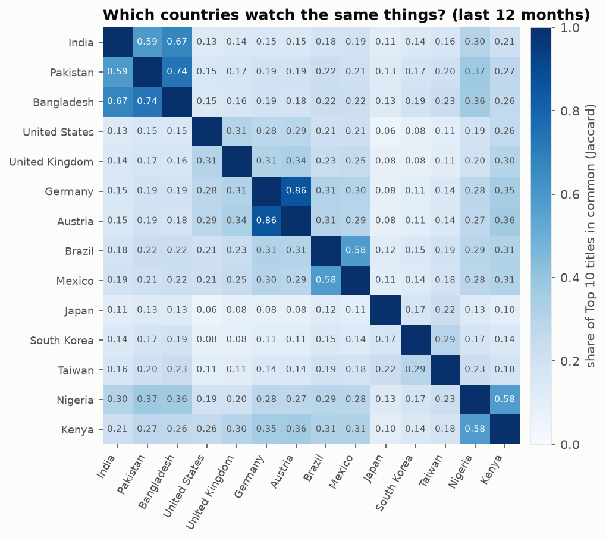

Germany and Austria share **86%** of their Top 10 titles; India's closest twin is Bangladesh (0.67), and Pakistan's is also Bangladesh (0.74). **Japan is the most distinct** country, whose best match (Taiwan) shares only 22%. India's local hits that barely charted elsewhere include *Mahavatar Narsimha*, *Dhurandhar (Raw & Undekha)* and *Saare Jahan Se Accha*.

## How recommendation works

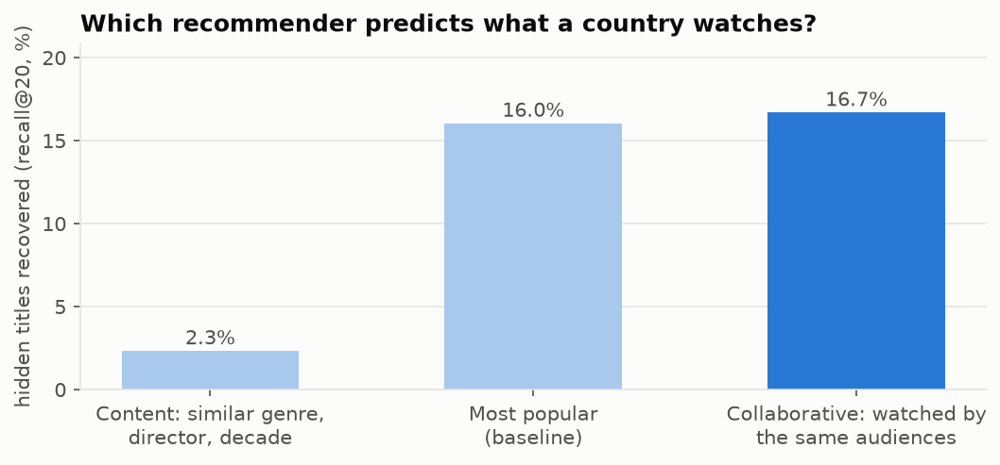

Netflix has described its system ([Gomez-Uribe & Hunt, 2015](https://dl.acm.org/doi/10.1145/2843948)) as many algorithms working together: a personalised ranker for every title and the rows on your home page ("Because you watched…", "Trending now", "Continue watching"). At the core is **learning from what similar viewers watched** (collaborative filtering), not just matching genres.

Individual viewing histories are private, so this project tests the same idea at country level. Each country's set of Top 10 titles acts as a "viewing history", 20% of it is hidden, and each method has to find the hidden titles in its top 20:

| Method | How it scores a title | Hidden titles found (recall@20) |
|---|---|---|
| Content | cosine similarity of genres, director, decade, film/series, language | **2.3%** |
| Most popular | charts in the most other countries | 16.0% |
| **Collaborative** | charts in the same countries as what you watched ("watched by the same audiences") | **16.7%** |

**What it shows:** similar genre alone barely predicts what people watch; audience behaviour does, which is why Netflix leans on it. Popularity is a strong baseline that collaborative filtering only just beats at this coarse, country level. Blending in content never helped on this test; content's job is the **cold start**, recommending a brand-new title nobody has watched yet.

Example ("Because you watched…", hybrid of both signals):

| Watched | Recommended |
|---|---|
| Stranger Things | The Sandman, Frankenstein, Something Very Bad Is Going to Happen, Zero Day |
| Squid Game | Man on Fire, Teach You a Lesson, Unfamiliar, Nemesis |
| Bridgerton | Emily in Paris, XO, Kitty, My Life With the Walter Boys, Zero Day |

## Quick start

```bash
git clone https://github.com/abpandey-dev/netflix-insights.git && cd netflix-insights
python -m venv .venv && source .venv/bin/activate
pip install -e ".[dev]"
pytest -q                                # tests on hand-made tables, no downloads

sh scripts/download.sh                   # ~600 MB: Netflix's published files + IMDb datasets into data/raw/
python scripts/make_report.py            # match titles, compute findings, draw charts (~1 min)
python scripts/make_diagrams.py          # README diagrams from the findings
```

## Project layout

```text
src/nfx/
  load.py        # read Netflix files and IMDb; title normalising and matching rules
  analysis.py    # concentration, genres, directors, decay, weekdays, countries
  recommend.py   # content / collaborative / popularity recommenders and the recall@20 test
  charts.py      # matplotlib charts
scripts/         # download.sh, make_report.py, make_diagrams.py
docs/            # diagrams and charts (aggregates only)
tests/           # matching rules (incl. the two bugs), metrics, recommenders
```

## Limits

- One half-year of title-level views (Jan-Jun 2026); Top 10 data covers 2021-2026 but only the top of each chart.
- Netflix rounds views to the nearest 100,000; titles under 100k views are grouped into "Other".
- 12% of views are not matched to IMDb (mostly non-English titles without an IMDb entry under the same name), so genre and director results describe the matched 88%.
- Country "viewing histories" are a stand-in for real member histories, which Netflix keeps private.
- **Not redistributed:** the raw files and joined dataset stay local (`data/` is git-ignored); IMDb data is for personal, non-commercial use. This repo has the code and aggregate findings only.
